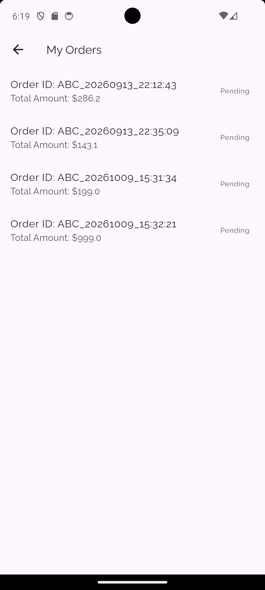
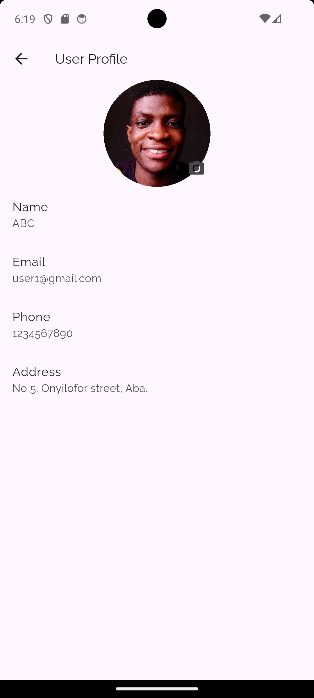
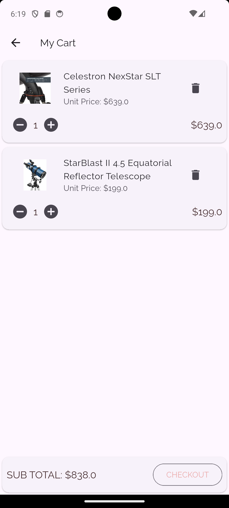
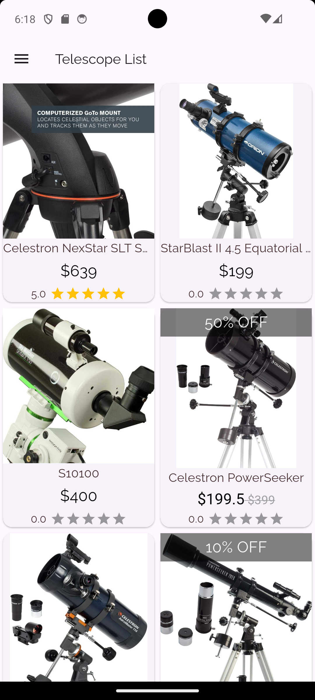
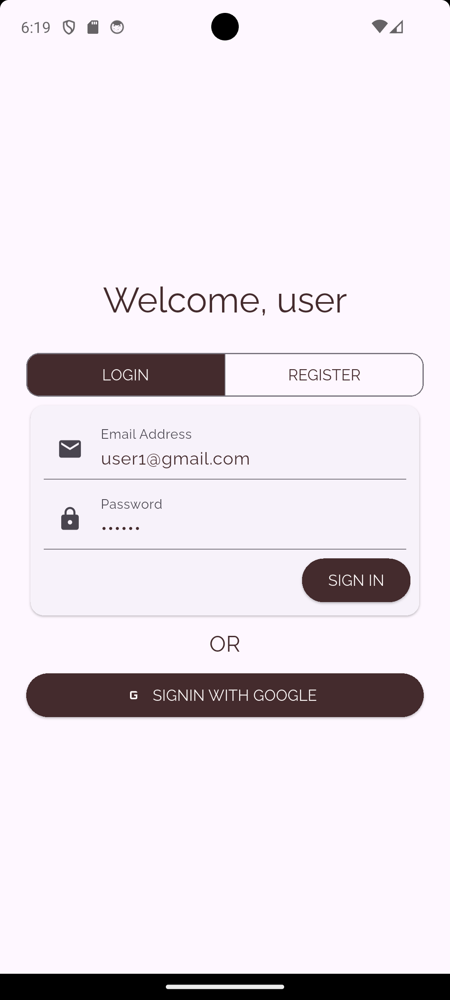

# Telescope Mart

Telescope Mart is a Flutter shopping application for browsing and ordering telescopes. It demonstrates a typical mobile-store journey: sign in, explore a live product catalogue, review product details, manage a cart, enter delivery details, and place an order.

The application uses Firebase for authentication and store data, and Supabase Storage for profile images. It is a learning project rather than a production-ready commerce platform: in particular, choosing online payment does not initiate a payment transaction.

## Features

- **Account access:** register and sign in with email and password, or use Google Sign-In.
- **Live product catalogue:** browse telescope products and brands loaded from Firestore, with product images, prices, discounts, and average ratings.
- **Product details and ratings:** see product stock and sale price, add or remove an item from the cart, and submit a star rating.
- **Persistent cart:** adjust quantities, remove items, and view a subtotal. Cart documents are stored under the signed-in user's Firestore record.
- **Checkout and order history:** provide a street address, postal code, and city; select a payment method; place an order; and view order status.
- **Profile:** review account and delivery information, and choose a profile photo from the camera or gallery. Photos are uploaded to Supabase Storage.
- **Order notification function:** a Firebase Cloud Function sends a notification to the `Order` messaging topic when an order document is created.

## Screenshots

| Order History | User Profile |
| --- | --- |
|  |  |

| Shopping cart | Product Catalogue |
| --- | --- |
|  |  |

| Login |
| --- |
|  |

## How it is built

### Mobile app

- **Flutter and Dart** provide the cross-platform UI and application code.
- **Material 3**, a Raleway text theme, and shared color constants define the visual style.
- **`go_router`** manages named routes; **Provider** and `ChangeNotifier` hold and expose user, telescope, cart, and order state.
- **Firebase Authentication** handles email/password and Google account sign-in.
- **Cloud Firestore** stores users, brands, telescopes, carts, ratings, and orders. Catalogue, cart, profile, and order data are read through Firestore streams where applicable.
- **Freezed** and **json_serializable** define model classes and generate their JSON conversion code.
- **Supabase Storage** stores profile pictures. Product images are displayed from the URLs saved with the Firestore product records.
- Other UI and device packages include `image_picker`, `cached_network_image`, `flutter_rating_bar`, `google_fonts`, and `flutter_easyloading`.

### Firebase Function

The `functions/` directory contains a JavaScript Cloud Function using the Firebase Functions v2 API and Firebase Admin SDK. The `sendOrderNotification` trigger watches new documents in `Orders` and sends a Firebase Cloud Messaging notification to the `Order` topic.

## Project layout

```text
lib/
  auth/                 Authentication helpers
  customwidgets/        Reusable login, product, cart, and drawer widgets
  db/                   Firestore reads and writes
  model_converters/     Firestore-specific model conversions
  models/               User, telescope, cart, order, brand, and image models
  pages/                Login, catalogue, detail, cart, checkout, order, profile
  providers/            App state and data-stream subscriptions
  utils/                Shared colors, constants, and helper functions
  main.dart             App initialization, providers, theme, and routes
functions/
  index.js              Order-created notification function
  package.json          Function scripts and Node.js engine requirement
```

## Requirements

- Flutter SDK with Dart **3.13.1 or later**, as declared in `pubspec.yaml`.
- Android Studio/Android SDK for Android, or Xcode on macOS for iOS.
- A Firebase project configured for the platforms you intend to run.
- A Supabase project with a Storage bucket named `profile_images` for profile photo uploads.
- For deploying the notification function: Node.js **24**, npm, and the Firebase CLI.

The checked-in Firebase options support Android and iOS only. Web, Windows, macOS, and Linux options have not been configured.

## Get it running

1. **Get the source and install Flutter dependencies.**

   ```sh
   flutter pub get
   ```

2. **Configure Firebase.**

   - Create or select a Firebase project and register your Android and/or iOS app with the matching application identifiers.
   - Enable **Email/Password** and **Google** providers in Firebase Authentication.
   - Create a Cloud Firestore database and populate the catalogue collections described below.
   - Configure Firebase Messaging if you want to receive the order-created notification.
   - Reconfigure the app for your Firebase project with the [FlutterFire CLI](https://firebase.google.com/docs/flutter/setup), or update the generated platform options and native app configuration to match your project. Google Sign-In also requires the correct OAuth client configuration; on Android, register the signing certificate fingerprints in Firebase.

   Firebase initialization currently uses generated options in `lib/firebase_options.dart`. Google Sign-In and Supabase initialization are also configured in `lib/main.dart`; replace those project settings with your own before running against a different backend. Do not commit private credentials or service-role keys.

3. **Configure Supabase Storage.**

   Create the `profile_images` bucket in your Supabase project and configure its access policies for the intended app behavior. Set the Supabase project URL and publishable key used by the app. A publishable key is intended for client use, but bucket policies must still protect uploaded data appropriately.

4. **Provide backend data.**

   The app expects these Firestore collections:

   | Collection/path | Purpose |
   | --- | --- |
   | `Brands` | Telescope brand records |
   | `Telescopes` | Catalogue records, including model, brand, price, stock, discount, rating, and image URLs |
   | `Users/{uid}` | User profile and delivery information |
   | `Users/{uid}/MyCartItems/{telescopeId}` | That user's cart items |
   | `Telescopes/{telescopeId}/Ratings/{uid}` | A user's rating for a telescope |
   | `Orders/{orderId}` | Placed orders and their status |

   The model definitions in `lib/models/` describe the document fields the app reads. Firestore security rules are not included in this repository; create and test rules that restrict access to the signed-in user's data and permit only the intended catalogue, rating, and order operations before using real accounts.

5. **Run on a configured device or emulator.**

   ```sh
   flutter devices
   flutter run
   ```

   In VS Code, open the project directory, select a Flutter device, and use **Run > Start Debugging**.

### Deploying the order notification function (optional)

From the project root, install the function dependencies and deploy to the Firebase project selected by the Firebase CLI:

```sh
npm --prefix functions install
firebase login
firebase use your-firebase-project-id
firebase deploy --only functions
```

Replace `your-firebase-project-id` with your Firebase project ID. The repository's `.firebaserc` currently names a default Firebase project; check the selected project before deployment. The function requires appropriate Cloud Functions and Firebase Cloud Messaging permissions and a billing-enabled Firebase plan where required. Devices must subscribe to the `Order` topic to receive those topic notifications.

## Useful development commands

```sh
flutter analyze
flutter test
dart run build_runner build --delete-conflicting-outputs
npm --prefix functions run lint
```

Run the code-generation command after changing Freezed or JSON-serializable model declarations.

## What a beginner can learn from building it

1. **Breaking a UI into screens and reusable widgets.** The login, catalogue, product details, cart, checkout, profile, and order-history screens illustrate how to divide an app by user task and extract repeated UI.
2. **Managing state and asynchronous data.** Providers expose state to widgets, while Firestore snapshots can update the UI when backend data changes.
3. **Connecting a mobile app to authentication.** The app combines Firebase email/password accounts with Google Sign-In and handles signed-in state when deciding which route to show.
4. **Designing models around stored data.** Freezed and JSON serialization reduce repetitive mapping code between Dart objects and Firestore documents.
5. **Implementing a basic shopping flow.** Product selection, cart quantities, subtotal calculation, checkout details, order creation, and stock updates show how related features fit together.
6. **Working with cloud storage and device capabilities.** Image picking demonstrates platform permissions and local files; uploading demonstrates sending those files to a hosted storage service.
7. **Adding server-side event handling.** The Cloud Function illustrates reacting to a Firestore document creation and sending a push-notification message.
8. **Handling platform configuration.** Firebase and Google authentication require setup outside Dart code, and features such as camera access and messaging need platform-specific configuration.

## Current limitations and next steps

- The **Online Payment** option is currently a checkout selection only. There is no payment provider, authorization, or payment confirmation flow.
- The repository does not include Firestore security rules or production-ready Supabase Storage policies.
- Google Sign-In, push notifications, and image picking need to be tested with platform credentials and permissions on real target platforms.
- The existing `test/widget_test.dart` is Flutter's starter counter smoke test; it does not test the Telescope Mart shopping flow yet.
- The login and registration forms currently start with sample field values. Replace or remove these defaults before distributing the app.
- Before production use, add meaningful automated tests, robust stock/price validation, safer order and inventory handling, and a complete payment flow if online payments are required.
